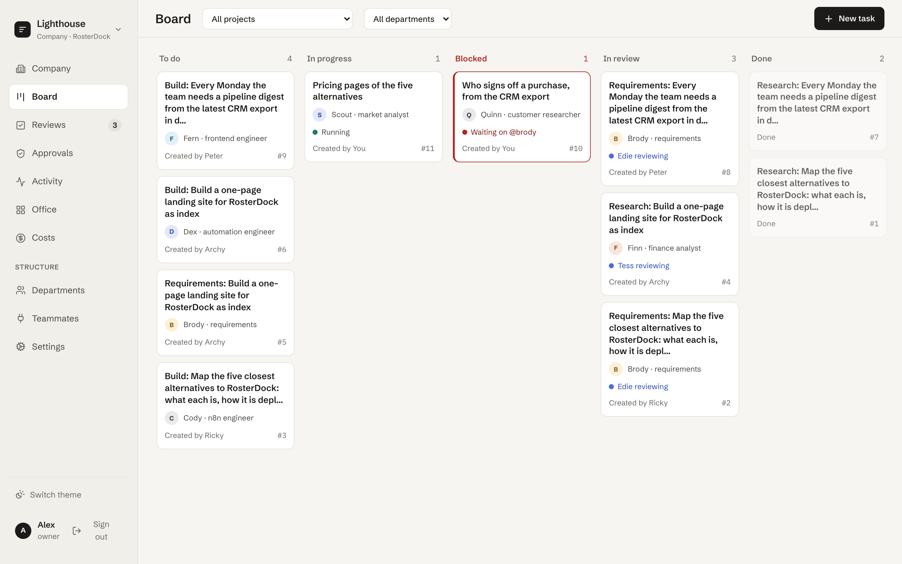

# RosterDock

AI teammates on your own Kubernetes cluster: a manager who plans, reviews that decide, a person approving
every live write.

[](https://github.com/DawBatteriesNotIncluded/RosterDock/actions/workflows/ci.yml)
[](LICENSE)

RosterDock is a self-hosted platform for departments of AI teammates, each a brain, a persona and a governed
toolbox, working a shared kanban. It is for teams that want agents doing real work with a manager, reviews
and an audit trail, on infrastructure they control.

- Only an approved review marks work Done, and a person can veto any review.
- A write to a live system runs only after a person approves its exact payload, bound by its sha256.
- Your cluster and your Postgres, with every credential referenced by name.
- Peter, the project-manager teammate, plans, chases and re-plans for Claude Code and Codex teammates in one
  company.

[Quick start](#quick-start-free-on-one-machine) · [Install on Kubernetes](docs/install.md) ·
[Security](docs/security.md) · [Demo companies](#demo-companies) · [Contributing](CONTRIBUTING.md)



_Lighthouse, an invented demo company, on the stub engine: tasks to do, running, waiting on a teammate, in
review and done._

## Status

Alpha, with breaking changes to come ([`CHANGELOG.md`](CHANGELOG.md)). Each release is published as three
images and a Helm chart; [`docs/install.md`](docs/install.md) installs one.

Good to know:

- Self-hosted only; engines are Claude Code, Codex and the stub.
- Claude Code on a cluster needs a worker image you build.
- A real install needs Kubernetes 1.27 or later, Postgres 16 and an OpenID Connect provider.

## Quick start: free, on one machine

Requirements: Node.js 22.13 or a later 22, or 24 or later, pnpm 10 (`npm install -g pnpm@10`, or
`corepack enable` on Node 22 or 24) and Docker. On the stub engine, with Peter without a model, nothing calls a
model and nothing costs anything.

```bash
git clone https://github.com/DawBatteriesNotIncluded/RosterDock.git
cd RosterDock
pnpm install
cp apps/board/.env.example apps/board/.env
cp apps/worker/.env.example apps/worker/.env
pnpm db:up          # Postgres, and MinIO for artifacts over 512 KB
pnpm db:migrate
pnpm dev
```

The board is on port 3000 and the web on http://localhost:5173. In a second terminal, start a worker (it runs
one teammate at a time):

```bash
pnpm dev:worker
```

Then, in the browser:

1. Sign in with any email and create a company; Peter is seated with it. The dev login lets anyone who
   reaches the board sign in as anyone and create companies, so it stays on this machine: a real install
   signs in through your identity provider and names who may create companies (`docs/install.md`).
2. **Teammates > Peter**: under Brain, pick the engine **No model (plans by role)**, so he never plans
   through a `claude` or `codex` CLI that happens to be signed in on this machine.
3. **Teammates > Hire from template**: Ricky (researcher), Brody (requirements) and a third teammate named
   Stubby with the role "n8n engineer", each with the engine **Stub (no model)**.
4. **Company > New goal**: "Send a weekly digest of Gong calls with next steps to #sales every Friday."
   Peter splits it into tasks, the worker runs the research task, and it lands in **Reviews**.

For real models, sign in to a CLI ([Engines](#engines)) and switch a teammate's engine; a company budget in
Settings caps the cost.

### Docker only

`docker compose --profile worker up --build -d` starts Postgres, MinIO, the board, the web and a worker on
http://localhost:8080; follow the same steps. Stub teammates need nothing; the worker is built with Claude
Code and hands Claude Code teammates `ANTHROPIC_API_KEY` from your environment. `docker compose down -v`
deletes the data.

## What it does

- **Teammates** are authors, assignees and reviewers with the same role checks as people; they message and
  delegate.
- **Toolboxes** grant any MCP server or OpenAPI service in a mode (`read`, `ask` or `off`); department and
  project client policies only narrow them.
- **Peter** plans with a model if there is one (perhaps asking questions first), by role if not.
- **Reviews** go hunk by hunk, with checks (secret scan, declared outputs, the repository's tests, cited
  sources, weighted criteria). On GitHub or GitLab an approval opens a pull or merge request; you merge.
- **One event stream** per company feeds activity, the office view and costs; budgets are in tokens; roles
  are owner, admin, reviewer and viewer; sign-in is OpenID Connect.

## How it fits together

```text
browser ──▶ web ──/api──▶ board ──────▶ connections (MCP, OpenAPI), git hosts, webhooks
                          ▲   │
            claim runs,   │   │ state, events
            events, files │   ▼
                       workers ──────▶ Postgres (every row, the events, the run queue)
                          │
                          ▼
                      model API
```

- **board** (`apps/board`): owns state and events, runs Peter, reviews and approvals; alone calls connections.
- **web** (`apps/web`): the React app; nginx proxies `/api` to the board.
- **workers** (`apps/worker`): run engines headless. They run model output, so on a cluster with
  `networkPolicy.enabled` (on in `examples/production.yaml`) they reach only the board, Postgres and public
  HTTPS.
- **Postgres** holds everything; an S3 bucket is optional, for artifacts over 512 KB.

More in the [operator guide](docs/operator.md).

## Engines

Only real engines need anything:

| Engine          | What the worker needs                                                                                         |
| --------------- | ------------------------------------------------------------------------------------------------------------- |
| Stub (no model) | Nothing. It writes the task's declared outputs and a handover; no model, no tokens, no cost.                  |
| Claude Code     | The `claude` CLI, signed in (`claude auth login`), or `ANTHROPIC_API_KEY` or `CLAUDE_CODE_OAUTH_TOKEN` for it |
| Codex           | The `codex` CLI, signed in (`codex login`), or `OPENAI_API_KEY` for it                                        |

Peter needs nothing either: without a model he plans by role (research, requirements, build). With
`ANTHROPIC_API_KEY` on the board, or a signed-in `claude` or `codex` CLI where the board runs, he plans
with a model; each company picks his engine on his page under Teammates, as for every teammate. Settings >
Models lists what the board has, and whether each CLI is signed in.

The worker image built from `apps/worker/Dockerfile` carries Codex; Claude Code's licence keeps it out of
public images ([Engines on the worker](docs/install.md#engines-on-the-worker)).

## On Kubernetes

A release's chart installs that release's images, against your Postgres and S3-compatible bucket:

```bash
helm upgrade --install rosterdock oci://ghcr.io/dawbatteriesnotincluded/charts/rosterdock --version 0.1.0 \
  -n rosterdock -f my-values.yaml --wait
```

[`docs/install.md`](docs/install.md) takes a fresh cluster there, its Secrets and `my-values.yaml` first.
From a checkout, `deploy/scripts/local-cluster.sh` keeps a kind cluster and `deploy/scripts/smoke.sh` makes a
throwaway install. Guides: [install](docs/install.md), [operator](docs/operator.md),
[security](docs/security.md) and the [docs index](docs/README.md).

## Demo companies

[Lighthouse](deploy/demo/lighthouse/README.md) launches a product, and [Cirrus](deploy/demo/cirrus/README.md),
a telecoms company, recovers from a bad week. Both are invented; their guides set them up and give costs.

## How this repository is worked

A RosterDock company on the maintainer's board (Engineering, Issues & PRs, Docs, Release & Security, and
Peter) takes tasks here. A reviewer teammate reviews each change it makes, the board opens the pull request
and a person merges ([#7](https://github.com/DawBatteriesNotIncluded/RosterDock/pull/7),
[#8](https://github.com/DawBatteriesNotIncluded/RosterDock/pull/8),
[#14](https://github.com/DawBatteriesNotIncluded/RosterDock/pull/14),
[#15](https://github.com/DawBatteriesNotIncluded/RosterDock/pull/15)). Most of the history is the
maintainer's.


_The company that works this repository, at a quiet moment: teammates with nothing on take a break in the
kitchen or the lounge, Peter among them._

## Contributing

[`CONTRIBUTING.md`](CONTRIBUTING.md) has the setup and the rules. Report a security problem privately, as
[`SECURITY.md`](SECURITY.md) says, and see the [code of conduct](CODE_OF_CONDUCT.md).

## Licence

Apache License 2.0: see [`LICENSE`](LICENSE). RosterDock is a dock for your roster of AI teammates.
